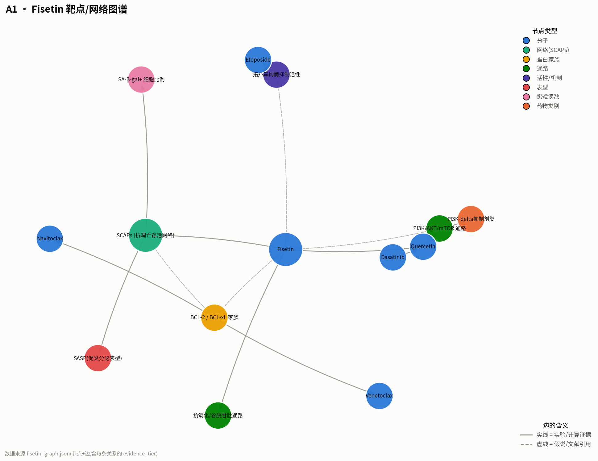
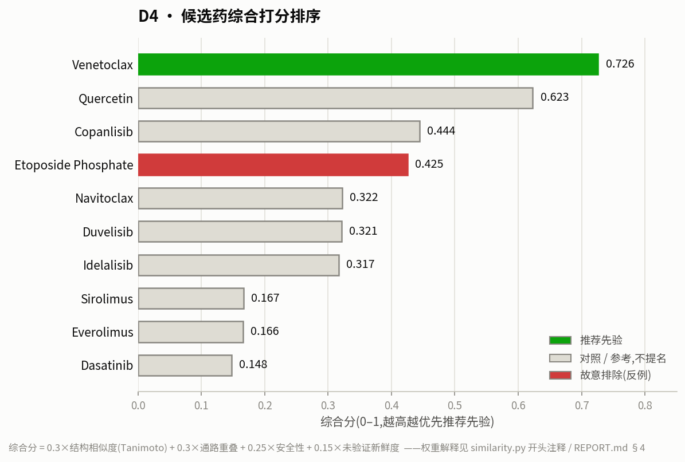

# Week 0 · Fisetin Pilot — zhuncharlie(solo,覆盖 A1/A2/B/C/D 多工位)

## 0. 关于"矛盾"的裁决(写在最前面,因为它决定了下面整份报告的表头)

《任务交代》的 REPORT 模板要求"靶点表"(target protein),但《论文配套手册》§5 明确指出:
**Fisetin 没有被原论文锁定在单一蛋白靶点上**,它是"表型/网络级"senolytic。
我用 ChEMBL 的真实数据验证了这个修正——Fisetin 在 ChEMBL 的 `mechanism`(已验证机制)
端点下查询返回 **0 条记录**,但在 `activity` 端点下有 **117 条弱到中等活性数据**,
散布在约 40 个互不相关的靶点上(详见 fisetin_profile.md)。**我按手册的 schema 走,
不按任务书原始的"靶点表"走**——这是用数据验证过的决定,不是偷懒绕过任务。

## 1. 我用一句话讲清 Fisetin 是啥

Fisetin 是水果里的天然黄酮,在"10 种黄酮同台清衰老细胞"的擂台赛里胜出,
而且 85 周龄(约人类 75 岁)的老鼠这时候才开始喂药,照样把寿命和健康指标都拉长了。

## 2. 它打的是谁(按论文修正后的 schema,不是传统靶点表)

| candidate | target_type | target_or_network | evidence_tier | 我的信心 1–5 | 来源 |
|---|---|---|---|---|---|
| Fisetin | phenotypic/SCAPs-network | 抗凋亡存活网络,BCL-2家族是假说候选支,未被结合实验锁定 | 实验(表型,Fig.1/3/4/5) | 4 | 论文PDF + [ChEMBL](https://www.ebi.ac.uk/chembl/explore/compound/CHEMBL31574) |
| Fisetin | predicted/promiscuous-binder | 117条弱活性数据覆盖~40个无关靶点,AChE最强(12nM) | 预测(qHTS筛选) | 3 | [ChEMBL activity API](https://www.ebi.ac.uk/chembl/api/data/activity.json?molecule_chembl_id=CHEMBL31574) |
| Fisetin | PI3K/AKT/mTOR通路 | 论文Discussion引用的候选机制,与Quercetin的PI3K-delta机制同通路家族 | 文献引用(非本论文直测) | 2 | 论文p.9 |
| Fisetin | antioxidant/GSH通路 | 升高GSH:GSSG比值,降低HNE加合物 | 实验(Fig.3F-G,5L-M) | 4 | 论文Fig.3,5 |

> 完整版 + 我为什么这么标,见 `fisetin_profile.md`;靶点/网络的图结构见 `fisetin_graph.json`。

> 节点颜色=类型(分子/网络/蛋白家族/通路…),边的实线/虚线=证据档位(实验/计算证据 vs
> 假说/文献引用)——这张图本身就是"证据档位"这个概念的可视化版本。由 `plot_graph.py`
> 读 `fisetin_graph.json` 生成,数据以 JSON 为准,图是给人看的版本。

## 3. 同网络/同通路的已上市药(10 个,见 `candidate_table.tsv`)

按"该不该先验"从高到低排序(完整表格 + 来源链接在 candidate_table.tsv):

| 药名 | 原本治啥 | 共享机制 | 已上市? | 安全性 | 我的动作建议 |
|---|---|---|---|---|---|
| Venetoclax | CLL/AML | BCL-2选择性抑制 | ✅ 2016 | 无black box,不打BCL-xL理论上更安全 | **推荐先验** |
| Idelalisib | CLL | PI3K-delta(同Quercetin机制) | ✅ 2014 | ⚠️black box(肝毒性/结肠炎/感染) | 参考,不提名 |
| Duvelisib | 淋巴瘤 | PI3K-delta/gamma | ✅ 2018 | ⚠️black box | 参考,不提名 |
| Copanlisib | 淋巴瘤 | 泛PI3K | ✅ 2017 | 仅IV给药,高血糖/高血压 | 参考,不提名 |
| Sirolimus | 器官移植抗排异 | mTOR | ✅ 1999 | ⚠️black box(免疫抑制) | 参考,不提名(已被广泛研究,非新鲜候选) |
| Everolimus | 多个肿瘤/心脏支架 | mTOR | ✅ 2009 | ⚠️black box | 参考,不提名 |
| Quercetin | — | 同黄酮家族,D+Q之Q | 仅膳食补充剂(ChEMBL max_phase=3) | 良好 | 阳性对照-近亲(必填) |
| Dasatinib | CML | 酪氨酸激酶 | ✅ 2006 | 强效TKI需关注长期毒性 | 阳性对照-搭档(必填) |
| Navitoclax | 肿瘤(临床) | BCL-2/BCL-xL双抑制 | ❌ **仅III期,未上市**(事实核查) | 血小板/中性粒细胞毒性 | 阳性对照-有毒标杆(必填),别推成候选 |
| Etoposide | 淋巴瘤/白血病 | 拓扑异构酶抑制(机制标签重叠) | ✅ 1996 | 强细胞毒性化疗药 | **故意不提名**——这是本论文自己用来**诱导**IMR-90细胞衰老的试剂,方向相反 |

## 4. 我自己的"打分"(这一格是我这周的灵魂)

- **我用的方法**:`A2_分子相似/zhuncharlie/similarity.py`——
  综合分 = 0.3×结构相似度(Morgan指纹Tanimoto) + 0.3×通路重叠(0/1/2人工标) +
  0.25×安全性(0/1/2,依据black box warning) + 0.15×"未验证新鲜度"(0/1)。
  **权重是我自己定的,偏见写清楚**:我故意把结构相似度压到 30%,因为这次任务最大的教训
  就是"长得像不代表是senolytic"——如果给结构相似度更高权重,分数会系统性偏向"像黄酮的分子",
  而忽略真正该看的是通路证据和安全窗口。
- **我排第一的是**:**Venetoclax**(综合分 0.726)。它是真正已上市的 BCL-2 家族药,
  且没有 Navitoclax 的血小板毒性包袱,在我查到的范围内没人直接测过它对衰老细胞的清除效果。
- **我故意没排进去的是**:**Etoposide**。它的综合分实际上排第 4(0.425,因为我给了它安全分 2,
  通路分 1),但这正好暴露了我这套打分公式的一个**盲点**——它不区分"同机制但方向相反"。
  Etoposide 是拓扑异构酶抑制剂没错,但在本论文里它的角色是**诱导**衰老的试剂
  (Methods 2.4节),不是清除衰老的候选。公式算不出"方向",只有我读了论文方法部分才知道。
  这是我这周踩过的一个真实的坑,没有藏起来。

## 5. 我最可能是错的这一步(必填)

**我把 Fisetin 标成 phenotypic/SCAPs-network,而不是写成"抑制 BCL-xL"这种确定性语言,
是因为 ChEMBL 查不到它和 BCL-2/BCL-xL 的直接结合数据;如果我硬写成"抑制 BCL-xL",
我会丢掉"机制未解析"这个事实本身——而这恰恰是整篇论文最诚实的地方。**

更具体地说,我最可能错在**我的打分公式本身**:它把"通路重叠"简化成了人工标注的 0/1/2,
这个标注是我自己读文献判断的,带有我自己的偏见(比如我给 Etoposide 标了"通路分1",
但其实它跟 Fisetin 的"拓扑异构酶抑制"只是文献里提了一句,不是本论文验证过的机制,
严格说应该标 0.5 甚至更低)。如果换一个人标,排名可能会变。

**我还可能被 Navitoclax 的"教科书级"标签骗过去**——如果我没去 ChEMBL 查 `first_approval`
字段,会一直以为它是"已上市阳性对照",但实际上它从没获批上市,只到临床三期。
任务书原文把它默认当"已上市"用,这本身就是一个会被轻易继承下去的错误。

## 6. 一周后,我想让湿实验先验什么?

> **Venetoclax 也打 BCL-2 家族(SCAPs假说里 Fisetin 的候选支),但没人测过它对
> IMR-90/MEF 衰老模型的 senolytic 活性。**
> 验法:IMR-90 细胞 + 依托泊苷诱导衰老,Venetoclax 剂量梯度(0.1–10μM)+ 48h,
> SA-β-gal 染色 + 总细胞数,跟 Fisetin(1–15μM)头对头比较红黑条差距。
> 若阳性,进一步做人脂肪外植块(20μM,48h)测 SASP 因子。完整方案见 `assay_plan.md`。

## 7. 诚实自检

- [x] 我亲眼点开/调用了 ≥3 个原始数据库接口(PubChem PUG REST、ChEMBL molecule/mechanism/activity/target/drug_indication 五个端点、Open Targets GraphQL),不是只抄综述
- [x] 我找出了至少两条"让我不舒服"的反例:① Navitoclax 其实没上市(任务书默认错了);② 我自己的打分公式会把"诱导衰老"的 Etoposide 排到第4名,因为它不懂方向性
- [x] 我敢站在组会上为第 6 节那个问题辩护 30 秒:Venetoclax 比 Navitoclax 安全、机制上说得通、但确实没见过直接证据,这正是"值得花一盒试剂盒去验"的典型情况,而不是"我猜它一定行"

## 附:我的 Fisetin 证据卡(来自 Yousefzadeh 2018, EBioMedicine)

- 体外:10 黄酮 @5μM,Fisetin 对 SA-β-gal+ 细胞最狠,总细胞相对保全(Fig.1A)
- 人细胞:IMR-90 依托泊苷衰老模型,1–15μM 剂量响应(Fig.1C)
- 人组织:脂肪外植块 20μM/48h,SA-β-gal+ ↓,SASP ↓(Fig.4E-F,n=3配对)
- 活体:老年野生鼠 85 周才给药 → 中位&最大寿命↑(Fig.5A-B)
- 安全性线索:蔬果天然成分,高剂量未见不良反应报告
- **我因此改主意的地方**:以为"查靶点表"=去数据库翻几个蛋白名字抄下来;查完 ChEMBL 117条
  活性数据后才发现,那样做会制造一张"假精确"的表——真实情况是它在几十个靶点上都只有弱活性。
- **我仍然不信的地方**:论文把效果归因于 SCAPs/BCL-2 家族,但没有一个敲低/敲除 BCL-xL 的
  必要性实验来证明因果,目前更像"合理的候选解释"而非确证机制。

---
**关联文件**:`fisetin_profile.md` · `fisetin_graph.json` + `fisetin_network.png`(`plot_graph.py`生成)
· `../../A2_分子相似/zhuncharlie/similarity.py` + `scores_chart.png`(`plot_scores.py`生成)
· `../../candidate_table.tsv` · `../../B_临床话术/elevator_pitch.md` + `assay_plan.md`
· `../../C_数据地基/dataset.yaml` + `run.sh` · `../../D_生物翻译/concept_cards.md`
